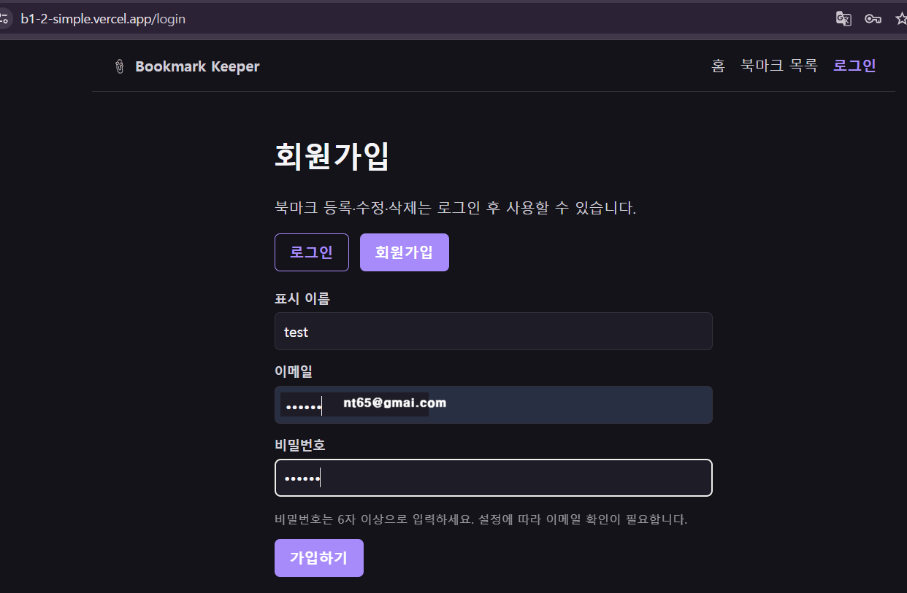
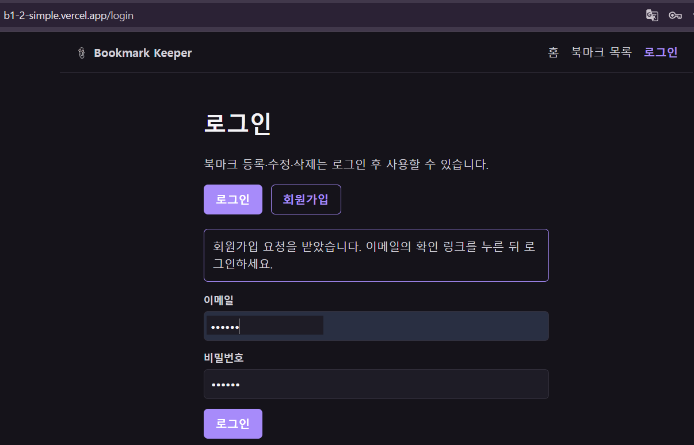

# b1-2 Bookmark Keeper

React + Supabase로 구현한 북마크 관리 SPA. 읽고 싶은 링크를 카테고리별로 저장하고, 메모를 남기고, 목록/상세/등록/수정/삭제를 수행한다. 목록·상세는 공개하며, 등록·수정·삭제에는 로그인이 필요하다. 로그인 사용자끼리는 북마크를 공유한다.

- **현재 배포 URL**: https://b1-2-simple.vercel.app
- **소스 코드**: https://github.com/ntt65/B1_2_simple
- **참고 구현**: https://github.com/ntt65/B1-2

2026-11-10에 미구현 보너스였던 사용자 Context와 Supabase Auth를 추가했다. 현재 문서의 구현 설명은 이 변경을 반영한다. 아래의 과거 실행·배포 기록은 인증 추가 전 기록이며, 이번 변경의 실제 원격 DB 적용·배포 CRUD 검증 결과를 뜻하지 않는다.

등록 오류 수정 코드 [18f603e](https://github.com/ntt65/B1_2_simple/commit/18f603e)의 Vercel 배포 완료와 실제 배포 JavaScript 반영을 확인했다. 사용자 SQL 적용 후 평가 계정의 원격 API 로그인·CRUD도 모두 통과했다.

---

## 회원가입·로그인 화면과 평가용 계정

배포 사이트의 `/login`에서 회원가입을 선택하고 정보를 입력한 화면이다. 이미지의 이메일은 마스킹했다.



가입 요청 후 로그인 탭에 이메일 확인 안내가 표시된 화면이다.



평가용 로그인 정보는 다음과 같다.

| 항목 | 값 |
| --- | --- |
| 표시 이름 | `test` |
| 이메일 | `********@gmail.com` |
| 비밀번호 | `123456` |

이메일 주소는 개인정보 보호를 위해 마스킹했다. [로그인 화면](https://b1-2-simple.vercel.app/login)에서는 실제 평가용 이메일과 위 비밀번호를 사용한다. 이메일 확인이 완료되지 않았다면 가입 확인 메일의 링크를 먼저 열어야 한다.

---

## 미션 구현 결과

### 필수 요구사항 체크리스트

| 항목 | 결과 | 근거 |
| --- | --- | --- |
| 라우팅 5개 이상 | ✅ | 8개 라우트 (`/`, `/bookmarks`, `/bookmarks/new`, `/bookmarks/:id`, `/bookmarks/:id/edit`, `/login`, `/profile`, `*`) |
| 목록/상세 페이지 분리 | ✅ | `/bookmarks` (목록) ↔ `/bookmarks/:id` (상세) |
| Not Found 페이지 | ✅ | `*` → `NotFoundPage` (404 메시지 + 홈으로 링크) |
| 재사용 컴포넌트 8개 이상 | ✅ | 기존 공용 UI 13개와 `ProtectedRoute` (등록·수정·프로필 경로에서 재사용) |
| 커스텀 훅 1개 이상 | ✅ | `useBookmarks()`, `useBookmark(id)`, `useAuth()` 3개 |
| CRUD 전체 | ✅ 원격 API 검증 완료 | 전체 `schema.sql` 적용 후 평가 계정의 API 로그인·등록·단건 조회·수정·삭제 성공, 검사 행 모두 정리 |
| 폼 필수값 검증 | ✅ | `validate()` — title, url 필수값과 HTTP/HTTPS URL 형식 검증 |
| 폼 에러 메시지 표시 | ✅ | 필드 바로 아래 인라인 에러 메시지, `invalid` 클래스로 테두리 강조 |
| 제출 중 상태 표시 | ✅ | `submitting: true` → 버튼 비활성화 + "처리 중..." 텍스트 |
| 로딩/에러/빈 상태 통일 | ✅ | `Loading`, `ErrorState`, `EmptyState` 공용 컴포넌트로 모든 화면 통일 |
| 상태 → 렌더 변화 3곳 이상 | ✅ | 카테고리 필터, 로딩, 검증 에러, 제출 중, 삭제 에러, 사용자 상태, 성공 안내 |
| 배포 | 수정 코드 배포·원격 API 로그인/CRUD 확인 | Vercel 완료 상태와 실제 배포 JavaScript 반영 확인. 브라우저 전체 UI 조작·신규 확인 메일 복귀는 별도 검증 필요 |
| 보너스: 성능 최적화 | ✅ | `useMemo` (필터 결과), `useCallback` (refetch 메모이제이션) |
| 보너스: 전역 상태 | ✅ | `AuthContext`의 사용자·세션 확인 상태를 헤더·로그인·프로필·보호 라우트에서 공유 |
| 보너스: 인증 | ✅ | Supabase 이메일 로그인·회원가입·로그아웃, 보호 라우트와 로그인 후 원래 경로 복귀 |

---

### 과제 목표 달성

> 미션이 끝난 후 스스로 설명할 수 있어야 하는 5가지 항목

**1. 컴포넌트를 어떤 기준으로 쪼갰는가**

두 기준으로 나눴다. ① `pages/`는 라우트 1개에 대응하며 Supabase 요청·`navigate` 같은 부수 효과를 담당한다. `components/`는 버튼·폼·상태 표시처럼 재사용하는 화면 조각을 담당한다. `Layout`·링크 카드·`ProtectedRoute`처럼 라우팅과 연결되는 컴포넌트도 있다. ② 같은 UI가 여러 곳에서 반복되면 컴포넌트로 추출했다 — 로딩/에러/빈 상태 3종, 등록·수정 공용 폼 `BookmarkForm`.

**2. props와 state의 차이, 상태를 어디에 두었는가**

- props: 부모가 자식에게 내려주는 읽기 전용 값. `BookmarkForm`이 받는 `initialValues`, `onSubmit`, `submitError`가 예시다.
- state: 컴포넌트 자신이 소유하고 변경할 수 있는 값. 비동기 데이터(`bookmarks`, `loading`, `error`)는 커스텀 훅이 소유, 카테고리 필터(`category`)는 `BookmarksPage`가 소유, 폼 값(`values`, `errors`, `submitting`)은 `BookmarkForm`이 소유한다.

**상태 배치 결정 기준**: 그 상태가 변할 때 리렌더가 필요한 컴포넌트 중 가장 가까운 공통 부모에 둔다. 로그인 사용자는 헤더·프로필·보호 라우트 등 여러 화면에서 필요하므로 `AuthContext`에서 공유한다. 폼 입력과 카테고리 필터는 해당 화면의 로컬 상태로 유지한다.

**3. useEffect가 언제 실행되고 의존성 배열이 어떤 역할을 하는가**

```js
// useBookmarks — 마운트 1회
const refetch = useCallback(async () => { /* Supabase select */ }, []);
useEffect(() => { refetch(); }, [refetch]); // refetch 불변 → 1회

// useBookmark(id) — id 바뀔 때마다 재조회
const refetch = useCallback(async () => { /* eq("id", id) */ }, [id]);
useEffect(() => { refetch(); }, [refetch]); // id 바뀌면 refetch 새 참조 → 재실행
```

의존성 배열은 이전/현재 값을 `Object.is`로 비교해 달라진 게 있으면 effect를 재실행한다. `useCallback`으로 `refetch`를 메모이제이션하지 않으면 렌더마다 새 함수가 만들어져 무한 루프가 생긴다.

예제의 최초 1회 조회는 일반적인 마운트 흐름을 뜻한다. 개발 모드의 StrictMode에서는 Effect가 추가 실행될 수 있으며, 세부 동작은 [tech.md](./docs/tech.md#react-strictmode-개발-동작)를 참고한다.

**흔한 실수 — `useCallback` 없이 함수를 의존성에 넣는 경우:**

```js
// ❌ 잘못된 패턴 — 무한 루프 발생
async function refetch() { /* Supabase 요청 */ }  // 렌더마다 새 함수 참조 생성
useEffect(() => { refetch(); }, [refetch]);         // refetch 항상 달라 보임 → 무한 재실행

// ✅ 올바른 패턴
const refetch = useCallback(async () => { /* Supabase 요청 */ }, []);
useEffect(() => { refetch(); }, [refetch]);          // refetch 불변 → 마운트 1회만 실행
```

**4. 비동기 흐름에서 로딩/성공/실패/빈 상태를 어떻게 표현했는가**

```jsx
{loading && <Loading message="북마크를 불러오는 중..." />}
{!loading && error && <ErrorState message="요청에 실패했습니다." onRetry={refetch} />}
{!loading && !error && <BookmarkList bookmarks={filtered} />}
// BookmarkList 내부: bookmarks.length === 0 → <EmptyState />
```

`loading` 여부와 `error` 값, 조회한 데이터의 유무로 네 상태가 겹치지 않게 처리했다.

**5. 라우팅 → 컴포넌트 → 상태 → 이벤트 → 렌더링 연결**

북마크 등록 흐름: "새 북마크" 클릭 → `/bookmarks/new` 매칭 → `ProtectedRoute`에서 세션 확인 → 비로그인이면 로그인 후 원래 경로로 복귀 → `BookmarkNewPage`와 `BookmarkForm` 렌더 → 입력 `onChange` → `values` state 갱신 → 제출 클릭 → `validate()` → `submitting: true` → Supabase `insert` → 성공 시 새 상세 페이지 이동 → 실패 시 폼을 유지하고 `submitError` 표시.

---

## 기능 구현

### CRUD 흐름

| 동작 | 진입 경로 | Supabase 쿼리 | 결과 |
| --- | --- | --- | --- |
| 목록 조회 | `/bookmarks` | `select("*").order("created_at", {ascending:false})` | 카드 목록 렌더, 카테고리 필터 적용 |
| 상세 조회 | `/bookmarks/:id` | `select("*").eq("id", id).maybeSingle()` | 제목/URL/메모/등록일 표시 |
| 등록 | `/bookmarks/new` → 폼 제출 | `insert(payload).select().single()` | 새 레코드 상세 페이지로 이동 |
| 수정 | `/bookmarks/:id/edit` → 폼 제출 | `update(values).eq("id", id).select("id").maybeSingle()` | 변경된 행 확인 후 해당 상세 페이지로 이동 |
| 삭제 | `/bookmarks/:id` → 삭제 버튼 | `delete().eq("id", id).select("id").maybeSingle()` | 삭제된 행 확인 후 목록 페이지로 이동 |

등록·수정·삭제는 로그인 세션을 확인한다. 등록 `payload`에는 폼의 `title`, `url`, `memo`, `category`만 선택하고 `user_id`는 확인한 세션 사용자의 ID로 채운다. `user_id`는 작성자 메타데이터이며 소유자만 수정·삭제하도록 제한하는 정책은 아니다. 수정·삭제 결과가 0행이면 성공으로 이동하지 않고 실패를 표시한다. 원격 DB에서도 같은 제한이 적용되려면 아래 복구·권한 SQL을 실제 Supabase 프로젝트에 적용해야 한다.

### CRUD 실패 케이스 처리

| 실패 유형 | 원인 | UI 동작 |
| --- | --- | --- |
| 목록·상세 조회 실패 | 네트워크 오류, Supabase 서비스 장애 | `error` state 설정 → `ErrorState` 렌더 ("요청에 실패했습니다.") + 재시도 버튼 |
| 등록 실패 | 필수 컬럼 누락, RLS 정책 거부 | DB 오류 코드와 누락 컬럼 등 필요한 원인을 안내하고 폼 유지. 원본 행·토큰 등 상세값은 표시하지 않음 |
| 수정 실패 | 존재하지 않는 id, RLS 정책 거부 | `submitError` state 설정 → 폼 상단 에러 표시, 현재 페이지 유지 |
| 삭제 실패 | 존재하지 않는 id, 네트워크 오류 | `deleteError` state 설정 → 삭제 버튼 위에 에러 메시지 표시, 페이지 유지 |
| 존재하지 않는 id 조회 | `.maybeSingle()` 결과 `null` | `!bookmark` 분기 → `ErrorState` ("해당 북마크를 찾을 수 없습니다.") |

모든 실패 케이스에서 페이지를 벗어나지 않고 인라인으로 오류를 표시한다. 재시도는 `refetch()` 직접 호출 또는 폼 재제출로 처리한다.

### 삭제·수정 후 목록 자동갱신 흐름

별도의 갱신 API 호출 없이 라우트 이동으로 자연스럽게 최신 데이터를 불러온다.

| 동작 | 이동 경로 | 갱신 원리 |
| --- | --- | --- |
| 삭제 성공 | `/bookmarks/:id` → `/bookmarks` | `BookmarksPage` 재마운트 → `useBookmarks`의 `useEffect` 재실행 → 최신 목록 재조회 |
| 수정 성공 | `/bookmarks/:id/edit` → `/bookmarks/:id` | `BookmarkDetailPage` 재마운트 → `useBookmark(id)`의 `useEffect` 재실행 → 수정된 단건 재조회 |
| 에러 재시도 | 동일 페이지 유지 | `ErrorState`의 재시도 버튼 → `refetch()` 직접 호출 → 로딩 상태 초기화 후 재조회 |

### 상태 → 렌더링 변화 포인트

| 상태 변화 | 렌더 결과 |
| --- | --- |
| `category` 드롭다운 선택 | `useMemo` 재계산 → 카드 목록 즉시 교체 (재조회 없음) |
| `loading: true → false` | `<Loading />` 사라지고 데이터/에러/빈 상태 렌더 |
| `errors.title` 설정 | `Input`에 `invalid` 클래스 + 필드 아래 에러 메시지 |
| `submitting: false → true` | 버튼 "처리 중..." + `disabled` |
| `deleteError` 설정 | 삭제 버튼 위에 에러 메시지 |
| 로그인·로그아웃으로 `user` 변경 | 헤더·프로필·등록/수정/삭제 메뉴와 보호 라우트가 함께 변경 |
| CRUD 성공 안내 전달·닫기 | 이동한 화면 상단의 성공 메시지를 표시·숨김 |

---

## 접근성(aria/role) 정책

공통 상태 컴포넌트에 ARIA 속성을 일관되게 적용했다.

| 컴포넌트 | ARIA 속성 | 의도 |
| --- | --- | --- |
| `Loading` | `role="status"` | 스크린 리더에 "로딩 중" 상태 알림 |
| `Loading` > spinner | `aria-hidden="true"` | CSS 스피너는 시각적 장식 요소 — 스크린 리더에서 숨김 |
| `ErrorState` | `role="alert"` | 스크린 리더에 즉시 오류 내용을 읽어줌 (assertive live region) |
| `BookmarkDetailPage` > 외부 링크 | `rel="noreferrer"` | 링크 대상이 `window.opener`에 접근하지 못하도록 보안 처리 |

`EmptyState`는 별도 ARIA role을 부여하지 않았다 — 빈 상태는 오류나 경고가 아니어서 사용자 주의를 즉시 끌 필요가 없기 때문이다.

---

## 폼 검증 정책

| 필드 | 검증 규칙 | 설명 |
| --- | --- | --- |
| `title` | 빈 문자열 불가 (`trim()`) | 필수 식별 정보 |
| `url` | 빈 문자열 불가 (`trim()`) | 핵심 데이터로 필수 |
| `url` 형식 | `new URL()`로 파싱 가능한 절대 주소이며 `http:` 또는 `https:`만 허용 | `http://localhost` 같은 주소도 허용 |
| `memo` | 미검증 | 선택 입력 필드 |
| `category` | 미검증 | `<select>`로 상수 목록 내에서만 선택 가능 — 잘못된 값이 입력될 수 없음 |

에러 메시지는 제출 시 한 번에 표시하고, 해당 필드를 다시 입력하기 시작하는 순간 지워진다 (`handleChange` 내 에러 클리어).

URL 검증은 `lib/bookmarkUrl.js`에서 공통 처리한다. 이전에 저장된 비HTTP/HTTPS 주소는 상세 화면에 텍스트로 표시하고 외부 링크로 열지 않는다.

---

## Supabase 선택 이유 및 연동 경험

**선택 이유**: PostgreSQL 기반이라 `schema.sql` 한 파일로 스키마·RLS 정책을 버전 관리할 수 있고, SDK 메서드 체이닝이 SQL과 1:1 대응되어 읽기 쉽다. Firebase(NoSQL)보다 단일 테이블 CRUD에 구조가 명확했다.

**연동 중 겪은 어려움**: `useEffect` + `useCallback` 의존성 배열 설정 실수로 무한 루프 발생. `refetch`를 `useCallback` 없이 의존성에 넣으면 렌더마다 새 함수 참조가 생겨 effect가 계속 재실행된다. `useCallback([])` / `useCallback([id])`로 메모이제이션해 해결했다.

**인증과 권한**: 선택 과제인 Supabase Auth와 사용자 Context를 추가했다. 목표 정책은 공개 조회·로그인 사용자 등록/수정/삭제다. `ProtectedRoute`가 등록·수정·프로필 경로를 보호하고, 페이지의 쓰기 처리와 DB의 RLS 정책이 각각 세션과 데이터 권한을 확인한다. 등록 시 `user_id`에 작성자 ID를 기록하지만, 작성자별 소유권 제한은 두지 않아 로그인 사용자는 모든 북마크를 수정·삭제할 수 있다. 이 정책은 SQL을 실제 DB에 적용해야 반영된다.

**연동 중 겪은 주요 에러와 해결:**

| 에러 | 원인 | 해결 |
| --- | --- | --- |
| `useEffect` 무한 루프 | `refetch`를 `useCallback` 없이 의존성에 넣어 렌더마다 새 참조 생성 | `useCallback([])` / `useCallback([id])`로 메모이제이션 |
| `.single()` 에러 | 없는 id 조회 시 단건이 아니라는 에러 발생 | `.maybeSingle()`로 교체 — 없으면 `null` 반환 |
| 환경변수 누락으로 앱 흰 화면 | 이전 구현은 `.env` 없이 실행 시 모듈 초기화에서 예외 발생 | 현재는 설정 안내 화면을 표시하고 `.env.example`과 배포 환경변수 등록으로 안내 |
| 원격 조회 `42703`: `column bookmarks.memo does not exist` | 기존 테이블에 `memo`가 없었다. `CREATE TABLE IF NOT EXISTS`는 이미 있는 테이블에 컬럼을 추가하지 않으며 `category`·`user_id`만 추가해도 앱 계약이 완성되지 않음 | 읽기 전용 진단 SQL로 구조를 확인한 뒤 갱신한 `schema.sql` 전체 실행. 앱은 확인한 작성자 ID를 등록 payload에 포함하고 DB 오류 원인을 안내 |

상세 내용(RLS 정책, useEffect 패턴, 버전) → [docs/tech.md](./docs/tech.md)

---

## 개발 환경

| 항목 | 내용 |
| --- | --- |
| 언어 | JavaScript (ES2020+), JSX |
| 프레임워크 | React 19 + React Router 7 |
| 빌드 도구 | Vite 8 |
| 백엔드 | Supabase (Postgres + PostgREST, `bookmarks` 테이블) |
| 배포 | Vercel |

버전 상세, DB 스키마, 환경변수, useEffect 패턴 → [docs/tech.md](./docs/tech.md)

---

## 폴더 구조

```
src/
├── App.jsx                  # 라우트 트리 루트
├── main.jsx                 # BrowserRouter + AuthProvider 진입점
├── context/
│   └── AuthContext.jsx      # 로그인 사용자·초기 세션·인증 이벤트 공유
├── lib/
│   ├── supabase.js          # Supabase 클라이언트 싱글턴
│   ├── constants.js         # 카테고리 상수
│   ├── authRedirect.js      # 로그인 복귀 경로·가입 메일 주소 검증
│   ├── bookmarkUrl.js       # HTTP/HTTPS URL 검증
│   └── bookmarkErrors.js    # DB 오류 코드·알려진 컬럼만 안내
├── hooks/
│   ├── useBookmarks.js      # 목록 조회 (loading/error/refetch)
│   ├── useBookmark.js       # 단건 조회 (loading/error/refetch)
│   └── useAuth.js           # AuthContext 사용
├── pages/                   # 라우트 단위 화면
│   ├── HomePage.jsx
│   ├── BookmarksPage.jsx    # 목록 + 카테고리 필터
│   ├── BookmarkDetailPage.jsx
│   ├── BookmarkNewPage.jsx
│   ├── BookmarkEditPage.jsx
│   ├── NotFoundPage.jsx
│   ├── LoginPage.jsx         # 이메일 로그인·회원가입
│   └── ProfilePage.jsx       # 사용자 정보·로그아웃
└── components/              # 공용 UI와 보호 라우트
    ├── Layout.jsx
    ├── Button.jsx / Input.jsx / Textarea.jsx / Select.jsx / Card.jsx
    ├── Loading.jsx / ErrorState.jsx / EmptyState.jsx
    ├── CategoryFilter.jsx / ProtectedRoute.jsx
    ├── SetupNotice.jsx      # Supabase 환경변수 누락 안내
    └── BookmarkCard.jsx / BookmarkList.jsx / BookmarkForm.jsx
```

### 파일 작성 규칙

| 대상 | 네이밍 | 예시 |
| --- | --- | --- |
| 페이지·UI 컴포넌트 | `PascalCase.jsx` | `BookmarkCard.jsx` |
| 커스텀 훅 | `camelCase.js` (`use` 접두어 필수) | `useBookmarks.js` |
| 유틸·클라이언트 | `camelCase.js` | `supabase.js`, `constants.js` |
| UI·훅은 named export | `export function Foo()` | 앱 루트 `App.jsx`는 default export |

---

## 라우트 (8개)

| 경로 | 화면 |
| --- | --- |
| `/` | 홈 |
| `/bookmarks` | 북마크 목록 (카테고리 필터) |
| `/bookmarks/new` | 북마크 등록 (로그인 필요) |
| `/bookmarks/:id` | 북마크 상세 |
| `/bookmarks/:id/edit` | 북마크 수정 (로그인 필요) |
| `/login` | 이메일 로그인·회원가입 |
| `/profile` | 사용자 정보·로그아웃 (로그인 필요) |
| `*` | Not Found |

### 네비게이션 링크 구조

`Layout.jsx`의 헤더에 홈·북마크 목록 링크를 제공하고, 로그인 상태에 따라 등록·로그인·프로필 메뉴를 표시한다. 현재 경로와 일치하는 링크에는 `active` 클래스가 자동으로 붙는다.

| 링크 | 경로 | `end` 옵션 |
| --- | --- | --- |
| 홈 | `/` | `true` — `/bookmarks` 등 하위 경로에서 active 방지 |
| 북마크 목록 | `/bookmarks` | — |
| 새 북마크 (로그인 사용자) | `/bookmarks/new` | — |
| 로그인 (비로그인 사용자) | `/login` | — |
| 내 프로필 (로그인 사용자) | `/profile` | — |

`end={true}` 없이 `/`를 NavLink로 사용하면 모든 경로에서 항상 active 상태가 된다. `end` 옵션으로 경로가 정확히 `/`일 때만 활성화되도록 처리했다.

---

## 컴포넌트 설계 기준

페이지 컴포넌트(`pages/`)와 UI 컴포넌트(`components/`)를 아래 기준으로 분리했다.

- **페이지 컴포넌트**: 라우트 하나에 대응하는 최상위 화면. 데이터 조회·CRUD 요청, 라우팅(navigate) 등 "무엇을 할 것인가"를 담당한다.
- **UI 컴포넌트**: 버튼·입력·카드·상태 표시 등 재사용할 화면 조각을 담당한다. 기본 입력 UI는 props로 제어하고, `Layout`·링크 카드·`ProtectedRoute`는 라우팅이나 사용자 Context도 사용한다.

### 컴포넌트 추출 기준

두 가지 규칙 중 하나라도 해당하면 컴포넌트로 추출했다.

1. **반복 패턴**: 동일한 UI 구조가 2곳 이상에 등장할 때
   - `Loading`, `ErrorState`, `EmptyState` — 목록·상세·수정 3개 페이지에서 동일하게 사용
   - `BookmarkForm` — 등록(`BookmarkNewPage`)과 수정(`BookmarkEditPage`)이 같은 필드 구성
2. **단일 책임**: 하나의 역할만 갖도록 경계를 그을 수 있을 때
   - `Button` — 클릭 요소의 스타일·상태만 담당 (내용·클릭 동작은 모름)
   - `BookmarkCard` — 카드 한 장 렌더만 담당 (목록·데이터 소스는 모름)
   - `BookmarkList` — 배열을 받아 카드를 나열하거나 EmptyState를 보여주는 역할만

기존 재사용 UI 13개와 추가한 보호 라우트:

| 컴포넌트 | 역할 | 사용 위치 |
| --- | --- | --- |
| `Layout` | 헤더·네비게이션 공통 레이아웃 | `App.jsx` (전 페이지 공통) |
| `Button` | variant/loading/disabled 버튼 | `BookmarkForm`, `BookmarkDetailPage`, `ErrorState` |
| `Input` | 텍스트 입력 + 에러 메시지 | `BookmarkForm` |
| `Textarea` | 여러 줄 입력 + 에러 메시지 | `BookmarkForm` |
| `Select` | 드롭다운 선택 | `BookmarkForm`, `CategoryFilter` |
| `Card` | 흰 카드 컨테이너 | `BookmarkCard` |
| `Loading` | 로딩 스피너 | `BookmarksPage`, `BookmarkDetailPage`, `BookmarkEditPage` |
| `ErrorState` | 에러 메시지 + 재시도 버튼 | `BookmarksPage`, `BookmarkDetailPage`, `BookmarkEditPage` |
| `EmptyState` | 데이터 없음 안내 | `BookmarkList` |
| `CategoryFilter` | 카테고리 드롭다운 필터 | `BookmarksPage` |
| `BookmarkCard` | 북마크 카드 한 장 | `BookmarkList` |
| `BookmarkList` | 카드 목록 (EmptyState 포함) | `BookmarksPage` |
| `BookmarkForm` | 등록/수정 공용 폼 | `BookmarkNewPage`, `BookmarkEditPage` |
| `ProtectedRoute` | 세션 확인·비로그인 사용자 로그인 이동 | 등록·수정·프로필 라우트 |

---

## 커스텀 훅

### 분리한 이유

조회하는 컴포넌트마다 Supabase 호출을 작성하면 같은 `useState` + `useEffect` 패턴이 중복된다. 조회 훅으로 분리하면 세 가지 이점이 생긴다. 등록·수정·삭제 요청은 각 페이지에서 직접 처리한다.

1. **재사용**: `useBookmark(id)`는 `BookmarkDetailPage`와 `BookmarkEditPage` 두 곳에서 동일하게 쓴다.
2. **관심사 분리**: 페이지 컴포넌트는 "어떻게 가져오는가"를 몰라도 된다. `loading`, `error`, `data`, `refetch`만 받아 화면에 집중한다.
3. **외부 호출**: `refetch`를 훅 밖에서 호출할 수 있어 삭제 후 목록 갱신, 에러 재시도에서 직접 사용한다.

### `useBookmarks()` — 목록 조회

```js
const { bookmarks, loading, error, refetch } = useBookmarks();
```

마운트 시 1회 Supabase에서 전체 북마크를 `created_at` 내림차순으로 가져온다. `refetch`는 `useCallback`으로 메모이제이션해 `useEffect` 무한 루프를 방지한다.

- 사용처: `BookmarksPage` (1곳)
- 재조회 트리거: 삭제 후 목록 페이지 재마운트, 에러 시 재시도 버튼

### `useBookmark(id)` — 단건 조회

```js
const { bookmark, loading, error, refetch } = useBookmark(id);
```

URL 파라미터 `id`가 바뀌면 자동으로 재조회한다 (`useCallback([id])` → `useEffect([refetch])`). `.maybeSingle()`로 결과 없을 때 에러 대신 `null`을 반환해 "찾을 수 없습니다" 화면을 별도 처리한다.

- 사용처: `BookmarkDetailPage`, `BookmarkEditPage` (2곳)
- 재조회 트리거: id 변경, 에러 시 재시도 버튼

**의존성 변화 시 예상 동작:**

| 상황 | 동작 |
| --- | --- |
| 같은 id로 재렌더 | `refetch` 참조 유지 → `useEffect` 재실행 안 함 |
| 다른 id로 이동 | `useCallback([id])`가 새 함수 생성 → `refetch` 참조 변경 → `useEffect` 재실행 → 새 id로 재조회 |
| 에러 후 재시도 | `ErrorState`의 `onRetry` → `refetch()` 직접 호출 → `loading` 초기화 후 재조회 |

---

## 로컬 실행 방법

Node.js 26에서 설치·빌드·테스트를 검증했다. 테스트 도구의 지원 버전은 Node.js 22.22.2 이상(22.x), 24.15.0 이상(24.x), 또는 26 이상이다.

```bash
npm install
cp .env.example .env   # Supabase 프로젝트의 URL/anon key로 채운다
npm run dev
```

Windows PowerShell에서는 `Copy-Item .env.example .env`로 복사할 수 있다. 실행 정책으로 `npm.ps1`이 막히면 동일한 명령을 `npm.cmd install`, `npm.cmd run dev`로 실행한다.

환경변수는 다음과 같다. `VITE_` 변수는 브라우저 번들에 포함되므로 공개 키만 사용하며 서비스 역할 키는 넣지 않는다.

```dotenv
VITE_SUPABASE_URL=https://your-project.supabase.co
VITE_SUPABASE_ANON_KEY=your-project-public-key
# 선택: 가입 확인 메일의 복귀 주소. 미설정이면 현재 브라우저의 origin 사용
VITE_APP_URL=http://localhost:5173
```

Supabase 테이블은 다음 순서로 준비한다. 이번 환경은 사용자가 전체 `schema.sql`을 실행해 누락 컬럼·기본값·공유 쓰기 권한을 보완했고, 이후 평가 계정의 API 로그인·등록·조회·수정·삭제를 모두 확인했다. 다음 절차는 새 환경이나 기존 테이블을 같은 계약에 맞출 때 사용한다.

1. SQL Editor에서 [supabase/diagnose-bookmarks.sql](./supabase/diagnose-bookmarks.sql)을 실행해 현재 컬럼·기본값·정책·테이블 권한 결과를 보관한다. 이 파일은 읽기 전용이다.
2. 신규 환경을 만들거나 기본값·공유 쓰기 권한까지 이 앱의 계약에 맞출 때는 [schema.sql](./schema.sql) 전체를 한 번 실행한다. 새 테이블 생성뿐 아니라 기존 테이블의 누락된 `memo`, `category`, `user_id`, `created_at`과 기본값을 보완하고, 공개 조회·로그인 사용자 쓰기 정책 및 API 스키마 새로고침까지 적용한다.
3. 진단 SQL을 다시 실행해 필요한 컬럼·기본값·정책 4개를 확인한 뒤 앱에서 등록·조회·수정·삭제를 재검증한다.

`schema.sql` 전체에는 권한 전환이 포함되어 있어 [policies-authenticated-writes.sql](./supabase/policies-authenticated-writes.sql)을 추가로 실행할 필요가 없다. 이 별도 파일은 컬럼이 이미 맞고 권한만 전환할 때 사용할 수 있다. 기존 컬럼의 타입·NOT NULL 제약·저장값은 임의로 변경하지 않으며, 기존 작성자 ID도 덮어쓰지 않는다. SQL 파일을 저장한 것만으로 원격 DB가 바뀌지는 않는다. 전체 기본값·권한 보완을 적용하려면 사용자가 SQL Editor에서 실행한다.

가입 확인 메일의 복귀 주소는 `VITE_APP_URL` 또는 현재 origin에 `/login?redirect=...`를 붙여 만든다. `VITE_APP_URL`을 사용한다면 이 앱의 주소로 설정한다. 기존 B1-2와 Supabase 프로젝트를 공유할 때는 **Authentication → URL Configuration**의 기존 Site URL·허용 주소를 유지하고, Redirect URLs에 `https://b1-2-simple.vercel.app/**`를 추가한다. 로컬 인증도 사용할 때는 `http://localhost:5173/**`를 별도로 허용한다. 현재 공개 인증 설정은 이메일 로그인·회원가입이 가능하고 이메일 확인이 필요한 상태다. 실제 새 확인 메일의 링크가 이 앱으로 돌아오는지 추가로 확인해야 한다.

새로 배포할 때는 Vercel에도 같은 공개 환경변수를 등록하고 다시 빌드한다. 현재 저장소에는 실제 `.env` 값이 포함되어 있지 않다. 이번 환경은 사용자 SQL 적용과 평가 계정의 원격 API 로그인·CRUD 검증을 완료했으며, 브라우저에서의 전체 UI 조작과 신규 가입 확인 메일 복귀는 별도로 확인한다.

### 검사 명령

```bash
npm run lint
npm test
npm run build
```

자동 테스트는 Supabase 응답을 대체해 인증 상태·보호 라우트·오류 처리를 확인한다. 실제 이메일 수신과 원격 RLS·배포 CRUD 확인은 별도로 필요하다.

2026-11-10 로컬 검증: `npm run build`, `npm run lint`, `npm test` 모두 통과했다. 테스트는 8개 파일의 62개 항목이며 인증·권한·URL 검증·조회 응답 경합과 누락 컬럼 오류·작성자 ID 전달·안전한 오류 안내를 포함한다. 갱신한 잠금 파일은 `npm ci --dry-run --offline`으로 일관성을 확인했다.

### 현재 배포 확인 범위

현재 배포 주소는 https://b1-2-simple.vercel.app 이다. 2026-11-10에 확인한 범위는 다음과 같다.

| 확인 대상 | 결과와 의미 |
| --- | --- |
| 사용자 제공 홈 화면 | Bookmark Keeper 홈·로그인 메뉴·공개 조회/로그인 쓰기 안내 확인 |
| 사용자 제공 회원가입·로그인 화면 | 회원가입 입력과 가입 요청 후 이메일 확인 안내 화면 확인 |
| 홈과 배포 JavaScript | HTTP 200 응답 확인 |
| 등록 오류 수정 코드 배포 | 커밋 `18f603e`의 Vercel 완료 상태와 실제 프로덕션 JavaScript의 새 오류 안내 코드 반영 확인 |
| `/bookmarks`, `/login`, `/bookmarks/new`, `/profile`, `/not-a-real-page` | HTTP 200과 React 앱 HTML 응답 확인. SPA rewrite의 HTTP 응답 확인이며, 각 화면의 렌더링·로그인 차단을 브라우저에서 검증한 것은 아님 |
| Supabase `GET /rest/v1/bookmarks?select=id&limit=0` | 이전 검사에서 HTTP 200. `id` 읽기 API 접근성만 확인하며 앱 전체 컬럼·등록 정상 여부를 검증한 결과가 아님 |
| 앱 사용 컬럼의 추가 API 검사 | 처음에는 `42703`: `column bookmarks.memo does not exist`. 사용자가 `memo` 추가·API 스키마 새로고침 후 `id,title,url,memo,category,user_id,created_at` 전체 및 개별 컬럼 조회 HTTP 200 확인 |
| Supabase `GET /auth/v1/settings` | HTTP 200. 이메일 인증 활성화, 회원가입 허용, 이메일 확인 필요 설정 확인 |
| 평가 계정의 API 로그인·등록·단건 조회 | 로그인 성공. 세션 사용자의 `user_id`를 포함한 임시 북마크 생성 HTTP 201·단건 조회 HTTP 200 확인 |
| 전체 SQL 적용 후 원격 API CRUD | 사용자의 `schema.sql` 전체 실행 후 새 임시 북마크 등록 HTTP 201·조회 HTTP 200·수정 HTTP 200·삭제 HTTP 200과 실제 반환 행 확인 |

원격 `memo` 누락과 수정·삭제 반환 0행 문제는 사용자 SQL 적용 후 해소되었다. 이전 검사에서 남았던 임시 북마크와 새 CRUD 검사 행을 모두 삭제했고, API 검증용 로그인 세션도 정리했다. 실제 사용자 식별값·토큰·공개 연결값은 문서에 기록하지 않았다. 위 API 검증은 브라우저에서의 전체 UI 사용 흐름이나 신규 가입 확인 메일의 수신·복귀를 검증한 결과는 아니다.

### `useAuth()` — 사용자 상태 공유

`AuthProvider`는 시작할 때 `getSession()`으로 세션을 확인하고 `onAuthStateChange()`로 로그인·로그아웃·세션 갱신을 반영한다. `useAuth()`는 `user`, `loading`, `sessionError`, `signIn`, `signUp`, `signOut`을 제공한다. 초기 세션 확인 중에는 보호 화면을 바로 노출하지 않으며, 확인 실패는 오류 UI로 표시한다.

로그인 성공 후에는 `redirect` 쿼리에 담긴 내부 경로로 복귀한다. `authRedirect.js`가 외부 주소·잘못된 인코딩·로그인 화면으로 돌아가는 경로를 걸러낸다. 회원가입 후 세션이 바로 생기지 않으면 확인 메일 안내를 표시하며, 프로필에서 표시 이름·이메일·가입일을 확인하고 로그아웃할 수 있다.

### 과거 실행 결과 (인증 추가 전)

```
$ npm install

added 312 packages in 8s

$ npm run dev

  VITE v8.1.1  ready in 342 ms

  ➜  Local:   http://localhost:5173/
  ➜  Network: use --host to expose
  ➜  press h + enter to show help
```

### 과거 배포 CRUD 확인 기록 (인증 추가 전)

이전 문서에는 배포 URL(https://codyssey-b1-2.vercel.app)에서 아래 시나리오를 확인한 기록이 있다. 인증 추가 후에는 쓰기 작업 전에 로그인해야 하며, 이 기록으로 현재 버전의 배포 상태를 보증하지 않는다.

**시나리오 1 — 등록 (Create)**
```
1. /bookmarks/new 접속
2. 제목·URL 미입력 상태로 "등록" 클릭
   → "제목을 입력하세요.", "URL을 입력하세요." 인라인 에러 표시 ✓
3. 제목: "React 공식 문서", URL: "https://react.dev", 카테고리: "개발" 입력 후 등록
   → 버튼 "처리 중..." 비활성화 ✓
   → 성공 후 /bookmarks/{새id} 상세 페이지 자동 이동 ✓
```

**시나리오 2 — 목록 조회 & 필터 (Read)**
```
1. /bookmarks 접속
   → 로딩 스피너 표시 후 카드 목록 렌더 ✓
2. 카테고리 드롭다운 "개발" 선택
   → 페이지 새로고침 없이 개발 카테고리 카드만 표시 ✓
3. "전체 카테고리" 선택 → 전체 목록 복원 ✓
```

**시나리오 3 — 수정 (Update)**
```
1. 카드 클릭 → /bookmarks/:id 상세 이동
2. "수정" 버튼 → /bookmarks/:id/edit 이동
   → 폼에 기존 값(제목·URL·메모·카테고리) 초기화 확인 ✓
3. 제목 수정 후 "수정 완료" 클릭
   → /bookmarks/:id 상세 페이지로 이동, 수정된 제목 표시 ✓
```

**시나리오 4 — 삭제 (Delete)**
```
1. 상세 페이지 "삭제" 버튼 클릭
   → 버튼 "처리 중..." 비활성화 ✓
   → 성공 후 /bookmarks 목록 이동 ✓
   → 삭제된 항목 목록에서 미노출 ✓
```

**시나리오 5 — 에러 & 엣지 케이스**
```
1. 존재하지 않는 경로(/abcdef) 접속 → 404 NotFoundPage 표시 ✓
2. /bookmarks/new 브라우저 직접 입력 → SPA rewrite로 정상 렌더 ✓
3. 목록이 빈 상태 → "표시할 데이터가 없습니다." EmptyState 표시 ✓
```

| 시나리오 | 결과 |
| --- | --- |
| Create — 유효성 검증 + 등록 후 이동 | ✅ |
| Read — 목록 조회 + 카테고리 필터 | ✅ |
| Update — 기존 값 초기화 + 수정 후 이동 | ✅ |
| Delete — 삭제 후 목록 이동 + 미노출 | ✅ |
| Not Found, 직접 URL 접근, Empty 상태 | ✅ |

### 과거 빌드 결과 (인증 추가 전)

```
$ npm run build

vite v8.1.1 building for production...
✓ 87 modules transformed.
dist/index.html                   0.46 kB │ gzip:  0.30 kB
dist/assets/index-BkR3qX2m.css   6.12 kB │ gzip:  2.01 kB
dist/assets/index-Dv9K7Lem.js  189.34 kB │ gzip: 61.48 kB
✓ built in 1.24s
```

---

## 이번에 추가한 UX

기존 개선 계획에 남아 있던 다음 기능도 구현했다.

- **빈 목록의 다음 행동**: 북마크가 없으면 새 북마크 등록으로 연결한다. 비로그인 사용자는 인증 후 등록한다. 카테고리 필터에만 결과가 없으면 전체 카테고리로 되돌릴 수 있다.
- **저장·삭제 성공 안내**: 등록·수정·삭제 성공 후 이동한 화면 상단에 `role="status"` 메시지를 표시한다. 자동으로 사라지는 토스트 대신 사용자가 닫을 수 있는 안내를 사용한다. `Layout`에서 라우트의 `state.notice`를 표시하므로 알림 전용 Context는 추가하지 않았다.
- **URL 형식 검증**: `bookmarkUrl.js`로 HTTP/HTTPS 절대 주소를 검증한다. 기존 데이터의 위험한 프로토콜 주소도 상세 화면에서 링크로 열지 않는다.

---

## 보너스 과제

| 항목 | 구현 여부 | 내용 |
| --- | --- | --- |
| 전역 상태 | ✓ | `AuthContext`에서 로그인 사용자·세션 확인 상태를 공유하고 `useAuth`로 사용 |
| 성능 최적화 (`useMemo` / `useCallback`) | ✓ | `BookmarksPage`에서 카테고리 필터 결과를 `useMemo`로 계산 — `bookmarks` 또는 `category`가 바뀔 때만 재계산. 두 커스텀 훅에서 `useCallback`으로 `refetch`를 메모이제이션해 `useEffect` 무한 루프 방지 |
| 인증 | ✓ | Supabase Auth 로그인·회원가입·로그아웃, 등록·수정·프로필 보호 라우트, 로그인 후 내부 경로 복귀 |
