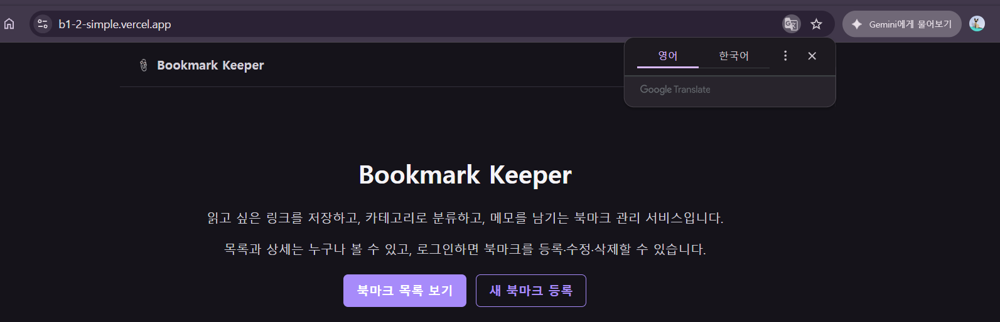
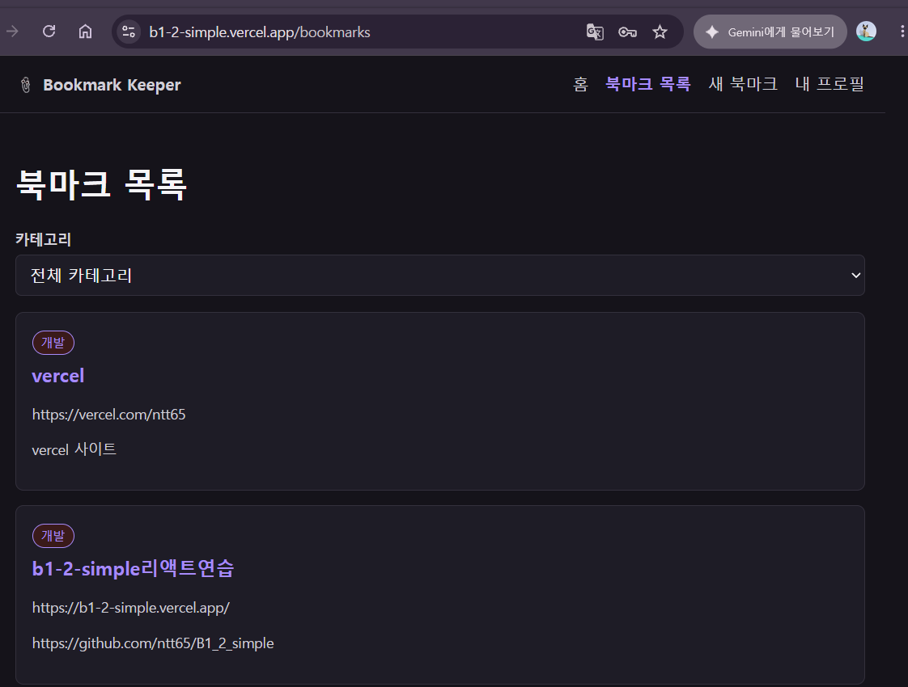
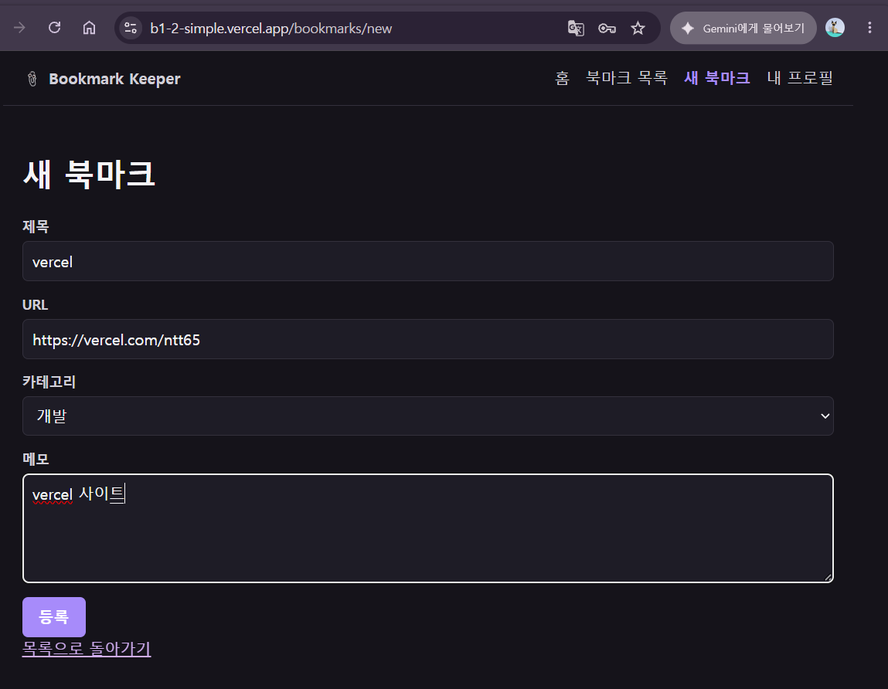
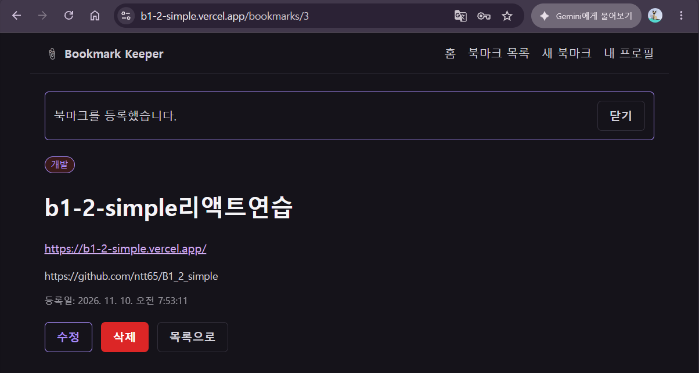
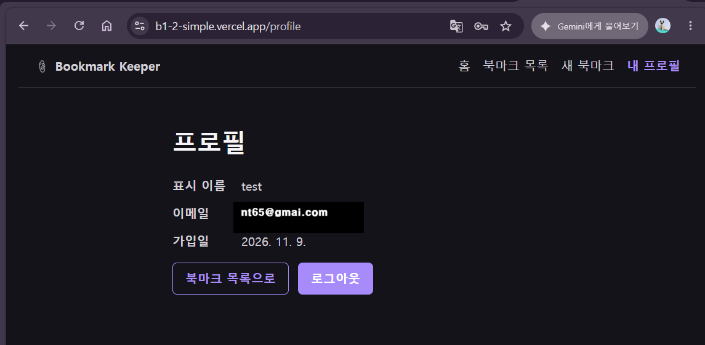

# B1-2 Bookmark Keeper

React와 Supabase로 만든 북마크 관리 SPA다. 링크를 저장하고 카테고리로 분류하며 메모를 남긴다. 목록과 상세는 공개하고, 등록·수정·삭제에는 로그인이 필요하다.

- **배포 사이트:** [b1-2-simple.vercel.app](https://b1-2-simple.vercel.app)
- **저장소:** [ntt65/B1_2_simple](https://github.com/ntt65/B1_2_simple)
- **비교 대상:** [ntt65/B1-2](https://github.com/ntt65/B1-2)
- **문서 기준일:** 2026-11-10

[로컬 실행](#로컬-실행-방법) · [기능과 권한](#기능과-권한) · [라우트](#라우트) · [코드 구조](#프로젝트-구조) · [실행 화면](#실행-화면) · [발표자료](#발표자료) · [배포 가이드](#vercel과-supabase-연동-및-배포-완벽-가이드) · [검증 결과](#현재-배포-확인-범위)

## 프로젝트 요약

| 항목 | 현재 구성 |
| --- | --- |
| 프론트엔드 | React 19, JavaScript JSX, React Router 7, 순수 CSS |
| 개발·빌드 | Vite 8, Node.js 26에서 검증 |
| 백엔드 | Supabase PostgreSQL·PostgREST·Auth |
| 화면 | 8개 라우트와 8개 페이지, 등록·수정·프로필 보호 |
| 재사용 UI | components 파일 15개, prop으로 표시·동작이 달라지는 컴포넌트 13개 |
| 커스텀 훅 | useBookmarks, useBookmark, useAuth |
| 테스트 | Vitest·Testing Library, 8개 파일의 62개 테스트 통과 |
| 호스팅 | Vercel, SPA rewrite 적용 |

사용자 Context와 인증 보너스까지 구현했다. 실제 API 로그인·CRUD 확인 기록과 자동 테스트, 사용자 제공 화면 캡처를 구분해 [검증 결과](#현재-배포-확인-범위)에 기록했다.

## 로컬 실행 방법

### 1. 설치와 환경변수 준비

Node.js 26에서 설치·빌드·테스트를 확인했다. 테스트 도구의 지원 범위는 Node.js 22.22.2 이상(22.x), 24.15.0 이상(24.x), 또는 26 이상이다. 실제 의존성과 명령은 [package.json](./package.json)과 [잠금 파일](./package-lock.json)을 따른다.

```bash
git clone https://github.com/ntt65/B1_2_simple.git
cd B1_2_simple
npm ci
```

Windows PowerShell에서 환경변수 템플릿을 복사한다.

```powershell
Copy-Item .env.example .env
```

macOS·Linux에서는 `cp .env.example .env`를 사용한다. `.env`를 열어 사용할 Supabase 프로젝트의 값을 입력한다.

```dotenv
VITE_SUPABASE_URL=https://your-project.supabase.co
VITE_SUPABASE_ANON_KEY=your-project-public-key
# 선택: 가입 확인 메일이 돌아올 앱의 origin. 생략하면 현재 브라우저 origin 사용
# VITE_APP_URL=https://b1-2-simple.vercel.app
```

URL과 공개 키는 **같은 Supabase 프로젝트**에서 가져온다. 기존 변수명 `VITE_SUPABASE_ANON_KEY`에 Publishable key(`sb_publishable_...`) 또는 legacy anon key를 입력할 수 있다. `VITE_` 값은 브라우저 번들에 포함되므로 서비스 역할 키나 계정 비밀번호를 넣지 않는다. [.env.example](./.env.example)에는 실제 연결값이 없으며 환경변수 파일은 [.gitignore](./.gitignore)로 제외한다.

### 2. Supabase 테이블 준비

새 환경을 구성하거나 기존 테이블을 앱의 계약에 맞출 때 다음 순서로 진행한다.

1. Supabase SQL Editor에서 [diagnose-bookmarks.sql](./supabase/diagnose-bookmarks.sql)을 실행해 기존 컬럼·제약·기본값·권한·정책을 확인하고 결과를 보관한다.
2. [schema.sql](./schema.sql) 전체를 검토한 뒤 실행한다. 이 파일은 신규 생성과 기존 `public.bookmarks`의 누락 컬럼·기본값 보완, 공개 조회·로그인 사용자 쓰기 정책을 함께 처리한다.
3. 진단 결과를 다시 확인하고 실제 로그인 세션으로 등록·조회·수정·삭제를 검사한다.

전체 `schema.sql`은 **bookmarks의 기존 RLS 정책을 교체한다.** 기존 데이터·컬럼 타입·NOT NULL·기존 외래키를 임의로 재작성하지는 않는다. 새 컬럼에 기본값이 들어가는 경우와 기존 숫자 ID의 자동 증가 설정은 아래 [데이터 모델](#데이터-모델)과 [SQL 트러블슈팅](#3-sql-트러블슈팅)을 확인한다. 파일 저장만으로 원격 DB가 바뀌지는 않는다.

컬럼과 기본값이 이미 맞고 권한만 전환할 때는 [policies-authenticated-writes.sql](./supabase/policies-authenticated-writes.sql)을 사용할 수 있다. 전체 `schema.sql`에는 이 권한 전환이 포함되어 있다.

### 3. 개발 서버와 검사

```bash
npm run dev
```

기본 주소는 `http://localhost:5173`이며 실제 주소는 터미널에 표시된다. 포트가 달라진 상태에서 메일 인증을 테스트한다면 해당 origin도 Supabase Redirect URLs에 허용한다. 환경변수를 수정한 뒤에는 개발 서버를 재시작한다. 설정 누락이나 URL 형식 오류 등으로 클라이언트를 만들 수 없으면 `SetupNotice`를 표시한다. 키의 유효성은 실제 요청 결과로 확인한다.

| 명령 | 용도 |
| --- | --- |
| `npm run dev` | 개발 서버 |
| `npm run lint` | Oxlint 검사 |
| `npm test` | Vitest 자동 테스트 |
| `npm run build` | 운영 빌드, 결과는 dist |
| `npm run preview` | 빌드 결과를 로컬에서 확인 |

PowerShell 실행 정책으로 `npm.ps1`이 막히면 `npm.cmd ci`, `npm.cmd run dev`, `npm.cmd test`처럼 실행한다. 로컬 preview 주소에서 메일 인증도 확인하려면 그 복귀 주소를 별도로 허용해야 한다.

## 기능과 권한

이 앱은 **공유 북마크 서비스**다. 로그인한 사용자는 다른 사용자가 등록한 북마크도 수정·삭제할 수 있다.

| 기능 | 비로그인 사용자 | 로그인 사용자 |
| --- | --- | --- |
| 목록·상세·카테고리 필터 | 사용 가능 | 사용 가능 |
| 북마크 등록 | 로그인으로 이동 | 사용 가능 |
| 북마크 수정·삭제 | 로그인 필요 | 모든 북마크에 사용 가능 |
| 내 프로필·로그아웃 | 로그인으로 이동 | 현재 사용자 정보 표시 |
| 회원가입·로그인 | 사용 가능 | 로그인 화면 접근 시 내부 복귀 경로로 이동 |

`ProtectedRoute`가 등록·수정·프로필 접근을 제어하고, 각 쓰기 핸들러는 요청 직전에 세션을 확인한다. 최종 접근 권한은 DB의 GRANT와 RLS가 검사한다. 앱은 등록 시 `user_id`를 세션 사용자의 ID로 기록하지만, 현재 DB 정책은 작성자 소유권을 강제하는 정책이 아니다.

### CRUD와 화면 갱신

| 동작 | 요청 위치 | 처리와 다음 화면 |
| --- | --- | --- |
| 목록 조회 | useBookmarks | select 후 created_at 내림차순, 목록 렌더 |
| 상세 조회 | useBookmark(id) | id로 maybeSingle 조회, 없으면 찾을 수 없음 안내 |
| 등록 | BookmarkNewPage | title·url·memo·category와 user_id 저장, 새 상세로 이동 |
| 수정 | BookmarkEditPage | id로 update 후 반환 행 확인, 상세로 이동 |
| 삭제 | BookmarkDetailPage | id로 delete 후 반환 행 확인, 목록으로 이동 |

수정·삭제의 반환 0행은 성공으로 처리하지 않는다. 등록·수정·삭제 후 이동한 화면에 닫을 수 있는 성공 안내를 보여준다. 삭제 후에는 목록 페이지가 다시 마운트되어 조회하고, 수정 후에는 상세 페이지가 다시 조회한다. 재시도 버튼은 조회 훅의 `refetch()`를 직접 호출한다.

### 폼·오류·접근성

| 항목 | 현재 동작 |
| --- | --- |
| 필수값 | 제목·URL의 trim 결과가 비어 있으면 제출 차단 |
| URL | 파싱 가능한 HTTP·HTTPS 절대 주소만 허용. 기존 비허용 URL은 상세에서 링크로 열지 않음 |
| 메모 | 선택 입력 |
| 카테고리 | 일반 UI에서는 개발·디자인·글·영상·etc 중 선택. 별도 값 검증이나 DB CHECK 제약은 현재 스크립트에 없음 |
| 제출 중 | 입력·버튼 비활성화, 처리 중 텍스트와 aria-busy |
| 요청 실패 | 입력 유지와 오류 표시. 등록 오류는 알려진 코드·컬럼을 안내하고 원본 행·토큰은 표시하지 않음 |
| 입력 오류 | label과 id 연결, aria-invalid·aria-describedby, 필드 가까이에 메시지 표시 |
| 공통 상태 | Loading은 role=status, ErrorState는 role=alert, 성공 안내는 role=status |

`Loading`과 `ErrorState`는 목록·상세·수정에서 공통으로 사용한다. **목록의 빈 결과**는 `BookmarkList` 안의 `EmptyState`가 등록·필터 초기화 액션과 함께 안내한다. 상세·수정에서 해당 ID가 없으면 `ErrorState`로 안내한다.

로그인 화면의 모드 선택은 밑줄형 탭으로, 제출은 입력창 너비의 보라색 버튼으로 구분했다. 로그인 탭에는 선택 상태와 키보드 포커스 표시가 있다.

## 라우트

| 경로 | 페이지 | 접근·역할 |
| --- | --- | --- |
| `/` | HomePage | 공개, 서비스 소개 |
| `/bookmarks` | BookmarksPage | 공개, 목록·필터 |
| `/bookmarks/:id` | BookmarkDetailPage | 공개, 상세·로그인 사용자 쓰기 메뉴 |
| `/bookmarks/new` | BookmarkNewPage | 로그인 필요, 등록 |
| `/bookmarks/:id/edit` | BookmarkEditPage | 로그인 필요, 수정 |
| `/login` | LoginPage | 로그인·가입·내부 경로 복귀 |
| `/profile` | ProfilePage | 로그인 필요, 사용자 정보·로그아웃 |
| `*` | NotFoundPage | 정의하지 않은 경로 안내 |

경로는 [App.jsx](./src/App.jsx), 공통 메뉴는 [Layout.jsx](./src/components/Layout.jsx)에 있다. 홈과 북마크 목록의 `NavLink`는 `end`를 지정한다. 정적 경로 `/bookmarks/new`와 동적 경로 `:id`는 Router가 구분한다.

Vercel의 rewrite는 직접 URL 요청에 앱 HTML을 제공한다. 따라서 잘못된 주소도 HTTP 200으로 HTML을 받은 뒤 React의 Not Found 화면을 표시할 수 있다. HTTP 상태와 앱 화면의 판단을 구분한다.

## 프로젝트 구조

```text
src/
├── App.jsx              # 8개 경로와 보호 라우트 연결
├── main.jsx             # BrowserRouter·AuthProvider·StrictMode
├── index.css            # 공통·반응형·다크 모드 스타일
├── pages/               # 8개 페이지, 요청과 이동 조정
├── components/          # 15개 UI·레이아웃·보호·설정 안내 파일
├── hooks/               # useBookmarks, useBookmark, useAuth
├── context/             # AuthContext
└── lib/                 # Supabase 연결·카테고리·URL·오류·복귀 주소 검증
supabase/
├── diagnose-bookmarks.sql
└── policies-authenticated-writes.sql
schema.sql               # bookmarks 생성·복구·권한 설정
tests/                   # 외부 API 없이 실행하는 자동 테스트
screenshot/              # 사용자 제공 화면 7장
docs/                    # 미션·평가·기술·운영 문서
output/
├── presentations/       # 미션·평가 PPTX
└── pdf/                 # 같은 내용의 발표 PDF
```

역할별 분리는 이 프로젝트의 설계다. React가 `pages/components/hooks` 폴더 이름을 강제하는 것은 아니다. `pages`는 화면의 요청·이동을 조정하고, 공통 UI를 `components`에서 재사용한다. `Layout`·링크 카드·`ProtectedRoute`는 Router 또는 인증 Context도 사용하므로 모든 UI가 props만 사용하는 순수 컴포넌트인 것은 아니다.

components 파일 15개 중 prop에 따라 표시·동작이 달라지는 13개는 `Button`, `Input`, `Textarea`, `Select`, `Card`, `Loading`, `ErrorState`, `EmptyState`, `CategoryFilter`, `BookmarkCard`, `BookmarkList`, `BookmarkForm`, `ProtectedRoute`다. `Layout`과 `SetupNotice`는 이 prop 기준 집계에서 제외한다. 등록·수정은 같은 `BookmarkForm`을 사용한다.

## React 구조와 데이터 흐름

### 커스텀 훅

| 훅 | 반환 값 | 사용 위치·역할 |
| --- | --- | --- |
| useBookmarks() | bookmarks, loading, error, refetch | 목록 조회와 재시도 |
| useBookmark(id) | bookmark, loading, error, refetch | 상세·수정 화면의 단건 조회 |
| useAuth() | user, loading, sessionError, signIn, signUp, signOut | AuthProvider의 공유 인증 상태 사용 |

조회 훅을 호출한 컴포넌트마다 로컬 상태는 독립적이다. 훅 코드를 재사용한다고 목록 상태가 전역으로 공유되지는 않는다. `useAuth`는 같은 AuthProvider의 Context를 읽으므로 여러 화면이 같은 사용자 상태를 사용한다.

### 상태 배치와 요청 처리

| 상태 | 위치 | 화면에 반영되는 예 |
| --- | --- | --- |
| bookmarks·bookmark·loading·error | 조회 훅 | 목록·상세·로딩·실패 표시 |
| category | BookmarksPage | useMemo로 필터 목록 계산 |
| values·errors·submitting | BookmarkForm | 입력·검증 오류·제출 중 표시 |
| submitError·deleteError | 페이지 | 저장·삭제 실패 안내 |
| user·loading·sessionError | AuthProvider | 헤더·프로필·보호 경로 분기 |
| state.notice와 닫기 상태 | Router·Layout | 이동 후 성공 안내 표시·숨김 |

Effect는 커밋 후 실행하며 의존성을 이전 값과 `Object.is`로 비교한다. `useCallback`은 조회 함수의 참조를 유지하고, 단건 조회의 `id`가 바뀌면 새 조회로 연결한다. 개발 StrictMode의 추가 setup·cleanup, 재마운트, 사용자의 재시도를 구분해야 하므로 조회가 항상 한 번만 실행된다고 설명하지 않는다.

두 조회 훅은 요청 순서와 마운트 여부를 확인해 늦은 응답이 최신 상태를 덮지 않게 한다. `useBookmark`는 ID가 바뀐 첫 렌더에서도 이전 항목을 새 항목처럼 보여주지 않도록 가드한다. 필터 `useMemo`와 조회 `useCallback`을 적용했으며, 성능 개선 수치를 별도로 측정한 것은 아니다.

```text
새 북마크 경로 진입
  보호 라우트의 세션 확인과 로그인 복귀
  BookmarkForm의 입력 상태 변경
  제출 검증과 submitting 표시
  페이지에서 현재 사용자 확인 후 INSERT
  성공: 새 상세와 안내 표시 / 실패: 입력 유지와 오류 표시
```

구현 코드는 [조회 훅](./src/hooks/useBookmark.js), [공용 폼](./src/components/BookmarkForm.jsx), [등록 페이지](./src/pages/BookmarkNewPage.jsx)에서 확인한다. 자세한 개념 설명과 문항별 발표 답변은 [기술 문서](./docs/tech.md), [미션 QA](./docs/b1_2_mission_QA.md), [평가 QA](./docs/b1_2_evaluation_questions_QA.md)에 정리했다.

## 데이터 모델

앱은 `public.bookmarks`의 다음 7개 컬럼을 사용한다. INSERT 필드는 `title`, `url`, `memo`, `category`, `user_id`이며 ID와 생성 시각은 DB 기본값을 사용한다.

| 컬럼 | schema.sql의 신규 테이블 정의 | 용도 |
| --- | --- | --- |
| id | uuid, PK, gen_random_uuid() | 상세·수정·삭제 식별 |
| title | text, NOT NULL | 제목 |
| url | text, NOT NULL | 링크 |
| memo | text, nullable | 선택 메모 |
| category | text, NOT NULL, 기본 etc | 분류 |
| user_id | uuid, 기본 auth.uid(), auth.users 참조 | 작성자 기록 |
| created_at | timestamptz, NOT NULL, 기본 now() | 등록 시각·정렬 |

위 표는 **신규 생성 정의**다. 기존 테이블의 숫자 ID·타입·identity·제약을 UUID로 변환하지 않는다. UUID ID의 기본값만 없는 경우는 보완하지만, 자동 증가가 없는 기존 숫자 ID는 진단 후 별도로 처리해야 한다. 새로 추가되는 category·created_at은 기존 행에도 기본값이 채워질 수 있다.

신규 user_id 외래키는 계정 삭제 시 SET NULL이다. 이미 존재하는 외래키의 삭제 동작은 ADD COLUMN IF NOT EXISTS로 바뀌지 않는다. 앱은 `memo`를 사용하며, 필드 이름을 추측해 `notes`·`description`을 추가하는 방식으로 해결하지 않는다.

Supabase를 선택한 이유는 이 프로젝트의 테이블과 SQL, 인증을 한곳에서 관리하고 React SDK로 원격 요청을 연결하기 편했기 때문이다. 같은 프로젝트를 쓰는 두 앱의 테이블 구분과 공유되는 인증 설정은 [현재 운영 구조](#현재-운영-구조-vercel-2개와-supabase-1개)를 참고한다.

---

## 실행 화면

사용자가 배포 사이트에서 촬영해 제공한 스크린샷이다. 회원가입·로그인 캡처에는 상단 탭 스타일을 변경하기 전 모습이 포함되어 있다.

### 홈

서비스 소개와 북마크 목록·새 북마크 등록으로 이동하는 시작 화면이다.



<a id="evaluation-account"></a>

### 회원가입·로그인 화면과 평가용 계정

배포 사이트의 `/login`에서 회원가입을 선택하고 정보를 입력한 화면이다. 이미지의 이메일은 마스킹했다.


가입 요청 후 로그인 탭에 이메일 확인 안내가 표시된 화면이다.


평가용 로그인 정보는 다음과 같다.

| 항목 | 값 |
| --- | --- |
| 표시 이름 | `test` |
| 이메일 | `********@gmail.com` |
| 비밀번호 | `123456` |

이메일 주소는 개인정보 보호를 위해 마스킹했다. [로그인 화면](https://b1-2-simple.vercel.app/login)에서는 실제 평가용 이메일과 위 비밀번호를 사용한다. 이메일 확인이 완료되지 않았다면 가입 확인 메일의 링크를 먼저 열어야 한다.

### 북마크 목록

저장된 북마크의 제목·URL·메모와 카테고리 필터를 보여준다.



### 새 북마크 등록

제목·URL·카테고리·메모를 입력하는 등록 폼이다. 아래 캡처는 제출 전 입력 화면이다.



### 등록 완료·상세

등록 완료 메시지와 저장된 북마크 상세, 수정·삭제·목록 이동 버튼을 보여준다.



### 내 프로필

로그인한 사용자의 표시 이름·이메일·가입일과 로그아웃 버튼을 보여준다. 이미지의 이메일은 가림 처리했다.



---

## 발표자료

원문의 미션 번호와 평가 번호에 맞춰 QA를 보완하고 발표자료를 각각 만들었다. PPTX에는 발표자 노트와 편집 가능한 표를 넣었으며, PDF는 같은 슬라이드 순서와 내용을 담는다.

| 구분 | 번호 대응 | 보완한 QA | PPTX | PDF |
| --- | --- | --- | --- | --- |
| 미션 발표 | 원문 1~8번과 하위 항목 | [미션 QA](./docs/b1_2_mission_QA.md) | [18장 발표자료](./output/presentations/b1_2_mission_presentation.pptx) | [18쪽 PDF](./output/pdf/b1_2_mission_presentation.pdf) |
| 평가 발표 | 평가 17문항과 6번 평가결과 | [평가 QA](./docs/b1_2_evaluation_questions_QA.md) | [19장 발표자료](./output/presentations/b1_2_evaluation_presentation.pptx) | [19쪽 PDF](./output/pdf/b1_2_evaluation_presentation.pdf) |

QA 문서의 발표용 답변·근거 파일·시연 포인트를 함께 참고한다. 번호·코드·발표 파일 검사와 저장소 반영 결과는 [최종 체크리스트](./docs/b1_2_presentation_checklist.md)에 기록한다.

---

## Vercel과 Supabase 연동 및 배포 완벽 가이드

이 가이드는 현재 Bookmark Keeper의 **공개 조회 + 로그인 사용자 전체 쓰기** 구조를 기준으로 한다. `user_id`는 작성자 기록이며, 로그인 사용자는 다른 사용자가 등록한 북마크도 수정·삭제할 수 있다. SQL의 기준 파일은 [schema.sql](./schema.sql)이고, 기존 환경의 구조를 읽는 파일은 [diagnose-bookmarks.sql](./supabase/diagnose-bookmarks.sql)이다.

### 현재 운영 구조: Vercel 2개와 Supabase 1개

2026-11-10에 두 배포본의 Supabase 프로젝트 주소와 저장소 코드를 대조했다. 두 Vercel 앱은 같은 Supabase 프로젝트를 사용하지만 **서로 다른 테이블에 저장한다.** Supabase 프로젝트 하나 안에는 여러 테이블을 둘 수 있으므로 현재 구성을 유지한다.

| 앱·Vercel 주소 | 사용하는 테이블 | 코드 근거 |
| --- | --- | --- |
| `B1-2` · [b1-2-puce.vercel.app](https://b1-2-puce.vercel.app) | `public.items` — 학습 아이템 | [B1-2의 테이블 지정](https://github.com/ntt65/B1-2/blob/main/src/lib/api.js#L9) |
| `B1_2_simple` · [b1-2-simple.vercel.app](https://b1-2-simple.vercel.app) | `public.bookmarks` — 북마크 | [simple의 목록 조회](./src/hooks/useBookmarks.js), [등록](./src/pages/BookmarkNewPage.jsx) |

두 앱이 모두 `bookmarks`를 사용한다는 가정은 실제 코드와 다르다. 현재 각 앱의 CRUD는 자기 테이블을 대상으로 하므로, 같은 Supabase 주소를 쓴다는 이유로 두 앱의 데이터가 자동으로 섞이지 않는다. simple의 SQL도 `public.bookmarks`를 대상으로 하며 기존 정책을 제거하는 구문은 `schemaname = 'public' AND tablename = 'bookmarks'`로 제한되어 `items`의 컬럼·정책을 직접 변경하지 않는다.

앞서 발생한 등록 오류는 `bookmarks.memo` 누락(`42703`)이었고, 수정·삭제의 반환 0행 문제는 해당 테이블의 권한·정책을 맞춰 해결했다. 전체 [schema.sql](./schema.sql) 적용 후 실제 로그인 세션으로 CRUD 반환 행까지 확인한 기록은 [현재 배포 확인 범위](#현재-배포-확인-범위)에 있다.

**운영 원칙과 향후 확장**

- 현재 `items`와 `bookmarks`를 유지한다. 이 구성을 위해 `app_id`를 추가하거나 기존 테이블 이름을 바꾸고 데이터를 이관할 필요는 없다.
- 향후 `b2_1`은 예를 들어 `public.b2_1_items`처럼 전용 테이블을 만든다. 이 이름은 향후 예시이며 아직 생성한 테이블이 아니다. 각 리포지토리의 SQL은 자기 테이블의 컬럼·권한·정책만 관리한다.
- `app_id`는 여러 앱이 같은 종류의 데이터를 한 테이블에서 의도적으로 공유할 때 검토한다. React의 `.eq('app_id', ...)`는 조회 필터다. 테이블 접두사도 이름 구분일 뿐이며, 접근 권한은 GRANT와 RLS로 제어한다. 현재의 로그인 사용자 전체 쓰기 정책 자체가 앱별 접근을 격리하지는 않는다. ([Supabase 권한과 RLS 안내](https://supabase.com/docs/guides/getting-started/api-keys#postgres-roles-and-row-level-security))
- 회원 계정과 인증 설정, 프로젝트 자원·중단 영향까지 독립적으로 운영해야 한다면 별도 Supabase 프로젝트를 사용한다. 단순히 Vercel 프로젝트가 두 개라는 이유로 Supabase도 두 개를 만들 필요는 없다.

**공유되는 인증 설정의 주의점**

회원 계정·Site URL·Redirect URLs·이메일 설정과 프로젝트 자원은 공유된다. 기존 앱의 Site URL과 허용 주소를 유지하고, 각 앱이 의도한 자기 주소로 인증 메일을 돌려받도록 아래 URL 설정을 적용한다. 서로 다른 도메인의 브라우저 저장소는 분리되므로 한쪽에서 로그인했다고 다른 쪽이 자동 로그인되는 것은 아니다.

현재 [AuthContext](./src/context/AuthContext.jsx)는 옵션 없는 `supabase.auth.signOut()`을 사용하며, SDK의 기본 범위는 `global`이다. 같은 계정의 다른 앱 세션 갱신에도 영향을 줄 수 있지만 다른 도메인의 화면이 즉시 바뀐다는 뜻은 아니다. 현재 세션만 종료하려면 `supabase.auth.signOut({ scope: 'local' })`로 바꾸는 방법을 검토할 수 있다. **이 문서 추가에서는 로그아웃 코드를 변경하지 않았다.** ([Supabase 로그아웃 범위 안내](https://supabase.com/docs/reference/javascript/auth-signout))

### 1. 기본 설정

**환경변수와 배포 대상**

Supabase 프로젝트의 **Connect** 화면에서 Project URL과 Publishable key를 확인한다. 키 관리는 **Settings → API Keys**에서 확인할 수 있다. 이미 사용하는 legacy `anon` 공개 키도 이 앱에서 사용할 수 있다. ([Supabase API 키 안내](https://supabase.com/docs/guides/getting-started/api-keys))

| 변수 | 필수 여부 | 이 프로젝트에서의 값과 역할 |
| --- | --- | --- |
| `VITE_SUPABASE_URL` | 필수 | 사용할 Supabase 프로젝트의 `https://...supabase.co` 주소 |
| `VITE_SUPABASE_ANON_KEY` | 필수 | 같은 프로젝트의 Publishable key 또는 legacy anon key. 코드 변수명은 그대로 사용하며 `sb_publishable_...` 값도 입력 가능 |
| `VITE_APP_URL` | 선택 | 가입 확인 메일이 돌아올 앱의 origin. Production 예시는 `https://b1-2-simple.vercel.app`이며, 생략하면 현재 접속 origin 사용 |

```dotenv
VITE_SUPABASE_URL=https://your-project.supabase.co
VITE_SUPABASE_ANON_KEY=your-publishable-or-anon-key
# Production에서 복귀 주소를 고정할 때만 설정
VITE_APP_URL=https://b1-2-simple.vercel.app
```

로컬에서는 `.env.example`을 `.env`로 복사한다. `VITE_` 변수는 Vite가 브라우저 코드에 포함하므로 서비스 역할 키나 계정 비밀번호를 넣지 않는다. 로컬 값을 바꿨다면 개발 서버를 재시작한다. ([Vite 환경변수 안내](https://vite.dev/guide/env-and-mode))

Vercel 프로젝트의 **Settings → Environment Variables**에서는 실제로 사용할 환경만 선택한다. Production은 운영 주소용, Preview는 필요한 미리보기 배포용으로 설정한다. Development 설정은 로컬 Vercel 도구를 사용할 때 필요한 범위로 선택하며, 일반 `npm run dev`는 로컬 `.env`를 사용한다. 모든 환경에 같은 값을 일괄 등록할 필요는 없다.

Vercel 환경변수를 바꿔도 기존 배포에는 반영되지 않는다. 대상 환경에 다시 배포하고, 수정한 커밋이 배포되었는지 확인한다. 이 프로젝트의 빌드 명령은 `npm run build`, 출력 폴더는 `dist`다. ([Vercel 환경변수 변경 안내](https://vercel.com/docs/environment-variables/managing-environment-variables))

**Vercel 프로젝트 생성·재배포 순서**

1. Vercel Dashboard에서 **Add New → Project**를 선택하고 이 GitHub 저장소를 Import한다.
2. **Framework Preset: Vite**, **Root Directory: `./`**, **Build Command: `npm run build`**, **Output Directory: `dist`**를 확인한다. 이 저장소는 하위 폴더가 아닌 루트에 앱이 있다.
3. 사용할 Supabase 공개 환경변수를 입력하고 **Deploy**로 첫 배포를 만든다.

기존 프로젝트의 값을 바꿀 때는 **Settings → Environment Variables → 변수 수정·적용 환경 선택 → Save** 순서로 저장한다. 이어서 **Deployments → 대상 환경의 최신 배포 → `...` → Redeploy**로 다시 배포한다. Production 설정을 바꿨다면 Production 배포를 선택하고, 완료 뒤 실제 운영 주소에서 확인한다.

**Supabase 인증 URL**

이 앱은 기존 B1-2와 Supabase 프로젝트를 공유하므로 **Authentication → URL Configuration**의 기존 Site URL과 기존 앱의 허용 주소를 유지한다. **Redirect URLs**에 이 앱의 주소를 추가한다.

```text
https://b1-2-simple.vercel.app/**
http://localhost:5173/**
```

로컬 인증을 쓰지 않으면 localhost 항목은 필요 없다. Preview 인증을 테스트할 때는 소유한 **해당 Preview 배포 주소만** 추가한다. 모든 Vercel 사이트를 허용하는 전역 와일드카드는 사용하지 않는다. 운영에서는 가능한 한 정확한 복귀 경로를 허용하되, 현재 코드가 `/login?redirect=...`처럼 동적 쿼리를 붙이므로 위 예시는 이 앱의 호스트 범위에서 허용한다. ([Supabase Redirect URL 안내](https://supabase.com/docs/guides/auth/redirect-urls))

새 Supabase 프로젝트를 단독 앱용으로 만드는 경우에만 그 앱의 Production origin을 Site URL로 설정한다. 공유 프로젝트의 Site URL을 새 앱 주소로 바꾸면 기존 앱의 기본 복귀 주소에도 영향을 준다.

`authRedirect.js`는 `VITE_APP_URL`이 있으면 그 origin을, 없으면 현재 브라우저 origin을 사용해 `/login?redirect=...` 주소를 만든다. Preview 환경에 Production의 `VITE_APP_URL`을 넣으면 확인 메일도 Production으로 돌아온다. Preview로 복귀시킬 목적이라면 해당 Preview origin을 사용하거나 이 선택 변수를 생략하고, 그 주소를 Redirect URLs에 허용한다.

**세션 유지와 페이지 새로고침**

인증 메일의 복귀 주소와 이미 로그인한 브라우저의 세션 복원은 별개의 흐름이다. `AuthProvider`는 저장된 세션을 `getSession()`으로 확인하고 `onAuthStateChange()`로 사용자 상태를 공유한다. 세션을 확인하는 동안 보호 화면은 로딩을 표시하고, 복원 오류는 오류 UI로 보여준다.

Production·Preview·localhost는 origin이 달라 브라우저 저장소와 로그인 상태가 자동으로 공유되지 않는다. 새로고침 후 로그인이 풀린다면 현재 origin, 저장소 사용 가능 여부, 세션 만료·갱신 요청, 초기 세션 확인 오류를 구분해 확인한다. Redirect URL 하나를 바꾸면 세션 유지 문제도 모두 해결된다고 가정하지 않는다.

`vercel.json`의 rewrite는 `/bookmarks/new` 같은 주소로 직접 들어가거나 새로고침할 때 React 앱을 제공한다. 잘못된 경로도 HTTP 200으로 앱 HTML을 받은 뒤 React의 Not Found 화면을 보여줄 수 있으므로, HTTP 응답만으로 화면 동작을 판단하지 않는다.

Vite SPA의 직접 접근·새로고침에서 호스팅 404가 발생하면 저장소 루트의 [vercel.json](./vercel.json)이 아래와 같은지 확인하고 다시 배포한다. 현재 프로젝트에 이미 포함된 설정이다. ([Vercel의 Vite SPA 설정 안내](https://vercel.com/docs/frameworks/frontend/vite#using-vite-to-make-spas))

```json
{
  "rewrites": [{ "source": "/(.*)", "destination": "/index.html" }]
}
```

### 2. 증상별 확인 표

| 증상·오류 | 확인할 내용 | 이 프로젝트의 처리 |
| --- | --- | --- |
| `Supabase 연결 설정이 필요합니다` | 대상 배포의 URL·공개 키, URL 형식, 환경변수 변경 후 재배포 여부 | `SetupNotice` 표시 |
| 로그인 정보 오류·`invalid_credentials` | 이메일·비밀번호, 계정이 생성된 Supabase 프로젝트 | 입력을 유지하고 인증 오류 안내 |
| `email_not_confirmed` | 가입 확인 메일의 링크를 열었는지 | 이메일 확인 후 로그인 안내 |
| 가입 요청 안내는 보이지만 메일 확인 여부가 불명확 | 수신함·스팸함, 메일 전송 제한, 새 메일 링크의 실제 복귀 주소 | 요청 안내만으로 이메일 확인·로그인 성공을 단정하지 않음 |
| 메일 링크가 기존 앱이나 localhost로 돌아감 | 해당 환경의 `VITE_APP_URL`, `emailRedirectTo`, Redirect URLs, 허용되지 않은 주소의 Site URL fallback | 공유 Site URL을 덮어쓰지 않고 새 앱의 복귀 주소 허용 |
| 새로고침 후 로그인 상태가 달라짐 | 같은 origin인지, 저장된 세션·갱신 요청·복원 오류인지 | `AuthContext`의 로딩·오류·비로그인 상태를 구분 |
| `42703`·`PGRST204` | 실제 컬럼 존재 여부와 PostgREST 스키마 캐시 | 누락된 알려진 컬럼과 오류 코드 안내 |
| `23502` | `user_id`, ID, 날짜 등 NOT NULL 컬럼의 payload·기본값 | 등록은 세션 사용자의 `user_id`를 전달. 기존 테이블의 추가 제약도 진단 |
| `42501`·권한 거부 | 로그인 세션, 스키마 USAGE, 테이블 GRANT, 적용된 RLS 정책 | 권한과 RLS를 함께 확인하도록 안내 |
| 수정·삭제 HTTP 200인데 결과가 없음 | 대상 행 존재 여부, SELECT·UPDATE·DELETE 권한과 RLS의 행 조건 | 반환 0행은 성공으로 이동하지 않음 |
| `23503`·`23514` | 사용자 참조 관계 또는 CHECK 제약과 실제 입력값 | 참조·허용 조건 확인 안내. 제약을 무조건 제거하지 않음 |
| 직접 URL 접근 시 Vercel 404 | rewrite 설정·배포 버전·실제 요청 주소 | React Not Found 화면과 호스팅 404를 구분 |

### 3. SQL 트러블슈팅

**먼저 실패한 요청의 응답을 확인한다**

브라우저에서 **F12 → Network**를 열고 등록을 시도한 뒤, 실패한 **POST `/rest/v1/bookmarks` → Response**를 확인한다. `code`, `message`, `hint`가 있으면 컬럼 누락·필수값·권한 오류 중 어느 문제인지 구분하는 데 사용한다. `hint`가 없거나 NULL일 수도 있다.

다른 사람에게 전달할 때는 오류 코드와 필요한 컬럼 이름만 추린다. Authorization·apikey 헤더, 토큰, 실제 이메일, 요청 payload나 실패한 행이 포함된 `details` 원문을 그대로 공유하지 않는다. 앱의 `bookmarkErrors.js`도 알려진 코드·컬럼만 안내하도록 구성되어 있다.

**먼저 실제 테이블을 읽어 확인한다**

Supabase SQL Editor에서 [읽기 전용 진단 파일](./supabase/diagnose-bookmarks.sql)을 실행해 컬럼·기본값·제약·트리거·RLS·GRANT 결과를 보관한다. 아래는 핵심 조회 예시다. 다른 테이블의 정책과 섞이지 않도록 스키마와 테이블 이름을 함께 제한한다.

```sql
select column_name, data_type, is_nullable, column_default, is_identity
from information_schema.columns
where table_schema = 'public' and table_name = 'bookmarks'
order by ordinal_position;

select policyname, roles, cmd, qual, with_check
from pg_policies
where schemaname = 'public' and tablename = 'bookmarks'
order by policyname;

select grantee, privilege_type
from information_schema.role_table_grants
where table_schema = 'public' and table_name = 'bookmarks'
  and grantee in ('anon', 'authenticated', 'PUBLIC')
order by grantee, privilege_type;
```

**누락 컬럼과 기본값을 맞춘다**

이 앱이 사용하는 컬럼은 `id`, `title`, `url`, `memo`, `category`, `user_id`, `created_at`이다. `CREATE TABLE IF NOT EXISTS`는 기존 테이블의 누락 컬럼을 추가하지 않는다. 이 프로젝트에서도 `category`·`user_id`만 보완한 기존 테이블에 `memo`가 빠져 실제 API에서 `42703`이 발생했다.

`memo` 하나만 빠졌다고 확인한 경우의 최소 수정 예시는 다음과 같다. 이 예시만으로 기본값이나 전체 권한까지 맞춰지는 것은 아니다.

```sql
alter table public.bookmarks add column if not exists memo text;
notify pgrst, 'reload schema';
```

신규 테이블 생성이나 전체 계약 복구에는 [schema.sql 전체](./schema.sql)를 사용한다. 이 파일은 누락 컬럼과 기본값, 공유 권한, API 스키마 새로고침을 한 번에 처리한다. 신규 `user_id` 정의는 다음과 같으며, 계정 삭제 시 북마크 행을 연쇄 삭제하지 않는다.

```sql
user_id uuid default auth.uid()
  references auth.users(id) on delete set null
```

위 구문은 컬럼 정의를 설명한 조각이며 단독 실행 SQL은 아니다. 기존 컬럼이 있으면 `ADD COLUMN IF NOT EXISTS`로 타입·NOT NULL·참조 제약이 바뀌지 않는다. 현재 `schema.sql`은 `category`, `user_id`, `created_at`의 기본값을 별도 ALTER로 보완하지만 기존 작성자 값이나 NULL을 임의로 채우지 않는다. 앱도 등록 직전 확인한 세션의 사용자 ID를 payload에 넣는다. SQL Editor에는 일반 사용자 JWT가 없을 수 있으므로 그곳에서 `auth.uid()`가 NULL인 것만으로 앱 로그인이 실패했다고 판단하지 않는다.

누락된 `category`·`created_at`을 새로 추가할 때는 기본값 `'etc'`·실행 시각이 기존 행에도 채워질 수 있다. 이미 있는 컬럼의 과거 NULL 값을 소급해서 바꾸는 작업과는 구분한다.

**기본 공유 정책은 GRANT와 RLS를 함께 설정한다**

현재 기본 계약은 누구나 조회하고 로그인 사용자 모두가 등록·수정·삭제하는 공유형이다. RLS는 테이블 권한을 대신 부여하지 않으므로 GRANT도 맞아야 한다. ([Supabase GRANT와 RLS 정책 안내](https://supabase.com/docs/guides/database/postgres/row-level-security#grants-and-policies))

컬럼이 이미 맞고 권한만 전환할 때의 예시는 다음과 같다. 기존 허용 정책은 OR로 합쳐질 수 있으므로 정책을 추가하기만 하지 않고 `public.bookmarks`의 기존 정책을 보관한 뒤 전환한다. 이 블록은 해당 테이블의 정책을 모두 교체하며, 전체 `schema.sql`을 실행했다면 다시 실행할 필요가 없다.

<details>
<summary>컬럼 구성이 정상일 때 사용하는 공유 권한 SQL</summary>

```sql
begin;

alter table public.bookmarks enable row level security;
grant usage on schema public to anon, authenticated;
revoke insert, update, delete on table public.bookmarks from anon;
grant select on table public.bookmarks to anon, authenticated;
grant insert, update, delete on table public.bookmarks to authenticated;

do $$
declare
  policy_row record;
begin
  for policy_row in
    select policyname from pg_policies
    where schemaname = 'public' and tablename = 'bookmarks'
  loop
    execute format('drop policy if exists %I on public.bookmarks', policy_row.policyname);
  end loop;
end;
$$;

create policy "bookmarks_public_read"
on public.bookmarks for select
to anon, authenticated using (true);

create policy "bookmarks_authenticated_insert"
on public.bookmarks for insert
to authenticated with check (auth.uid() is not null);

create policy "bookmarks_authenticated_update"
on public.bookmarks for update
to authenticated
using (auth.uid() is not null)
with check (auth.uid() is not null);

create policy "bookmarks_authenticated_delete"
on public.bookmarks for delete
to authenticated using (auth.uid() is not null);

commit;
```

</details>

정책 4행이 존재한다는 것만으로 완료는 아니다. 역할·명령·조건과 스키마/테이블 권한을 확인하고, 실제 로그인 세션으로 등록·조회·수정·삭제한 행을 확인한다. 이 프로젝트에서는 등록·조회는 성공해도 수정·삭제가 HTTP 200과 반환 0행이었던 적이 있다. 전체 SQL 적용 후 실제 반환 행까지 확인해 CRUD를 검증했다.

<details>
<summary>선택 설계: 사용자 본인 북마크만 다루는 앱으로 바꾸려면</summary>

이 설계는 현재 공유형 앱의 기본 설정이나 실행 순서에 포함되지 않는다. 소유자 전용으로 전환하려면 기존 `user_id IS NULL` 데이터와 계정 삭제 후 작성자가 없는 행의 처리 방식을 먼저 정하고, 다른 작성자의 수정·삭제 버튼을 숨기는 등 UI도 함께 바꿔야 한다.

그때의 정책 조건 예시는 다음과 같다. 기존 공유 허용 정책을 남긴 채 추가하면 OR로 결합되어 소유자 제한이 되지 않으므로, 별도 설계·검증 뒤 기존 정책을 교체해야 한다.

| 명령 | 소유자 전용 조건 예시 |
| --- | --- |
| SELECT | `USING (auth.uid() = user_id)` |
| INSERT | `WITH CHECK (auth.uid() = user_id)` |
| UPDATE | `USING (auth.uid() = user_id) WITH CHECK (auth.uid() = user_id)` |
| DELETE | `USING (auth.uid() = user_id)` |

기본 공유 정책의 `auth.uid() IS NOT NULL`은 로그인 여부를 검사한다. DB가 `user_id`와 로그인 사용자 ID의 일치까지 강제하는 조건과는 다르다. 위 선택 설계는 필요한 경우 별도 변경으로 다룬다.

</details>

### 4. 배포 전후 체크리스트

다른 환경을 구성할 때 사용하는 **빈 체크리스트 템플릿**이다. 문서·발표자료 검수 완료 기록은 [최종 체크리스트](./docs/b1_2_presentation_checklist.md)에 있다. 현재 배포의 실제 검사 결과는 아래 [현재 배포 확인 범위](#현재-배포-확인-범위)에 기록했다.

- [ ] 사용할 Supabase 프로젝트의 URL과 공개 키를 같은 프로젝트에서 가져왔다.
- [ ] 필요한 Vercel 환경에만 값을 설정하고 변경 후 다시 배포했다. 서비스 역할 키·계정 비밀번호를 `VITE_` 변수에 넣지 않았다.
- [ ] 공유 프로젝트의 기존 Site URL·허용 주소를 유지하고 이 앱과 필요한 개별 Preview/로컬 복귀 주소를 허용했다.
- [ ] 해당 환경의 `VITE_APP_URL` 또는 origin fallback이 의도한 메일 복귀 주소를 만든다.
- [ ] 진단 SQL로 7개 컬럼·기본값·제약과 스키마/테이블 권한·RLS 조건을 확인했다.
- [ ] 비로그인 공개 조회와 비로그인 쓰기 차단, 로그인 사용자의 등록·조회·수정·삭제를 실제 역할로 확인했다.
- [ ] 수정·삭제는 HTTP 200만 보지 않고 실제 반환 행과 변경 결과를 확인했다.
- [ ] `/bookmarks/new` 직접 접근·새로고침·Not Found UI와 로그인 후 원래 경로 복귀를 확인했다.
- [ ] 같은 origin에서 새로고침할 때 세션 복원과 로딩·오류 처리를 확인했다.
- [ ] 새 가입 확인 메일을 수신하고 링크가 이 앱으로 돌아오는 것을 확인했다.
- [ ] 검증용 북마크와 세션을 정리하고 로그·문서에 실제 토큰이나 사용자 식별값을 남기지 않았다.

---

## 검증 결과

### 현재 배포 확인 범위

2026-11-10에 확인한 기록이다. 현재 주소는 [b1-2-simple.vercel.app](https://b1-2-simple.vercel.app)이며, 구현·자동 테스트·실제 API·정적 캡처의 증거 범위를 구분한다.

| 구분 | 확인한 결과 | 범위 |
| --- | --- | --- |
| 로컬 검사 | build·lint 통과, 8개 파일의 62개 테스트 통과 | Supabase 응답을 대체한 인증·보호 경로·폼·URL·오류·조회 경합 검사 포함 |
| 배포 반영 | 등록 오류 안내 코드와 로그인 탭 스타일의 Vercel 반영 확인 | 실제 배포 JavaScript·CSS 확인 |
| SPA 직접 접근 | 홈과 주요 경로가 HTTP 200 및 앱 HTML 반환 | 전체 화면 조작·로그인 차단 검증을 뜻하지 않음 |
| 테이블 복구 | memo 누락 42703을 확인하고 사용자 SQL 적용 후 7개 사용 컬럼 조회 성공 | 진단 후 schema.sql 적용 |
| 원격 API | 평가 계정 로그인, 임시 북마크 생성 201·조회 200·수정 200·삭제 200 | 수정·삭제는 실제 반환 행까지 확인, 검사 행·세션 정리 완료 |
| 사용자 캡처 | 홈·회원가입·로그인 안내·목록·등록·상세·프로필 7장 | 촬영 시점의 정적 화면 근거 |
| 발표자료 | 미션 18장·평가 19장, PDF 페이지 수 동일 | 484개 문단 일치, 한글 글꼴 포함, 37장 개별 시각 검수와 수정본 검수 |

**추가 확인 대상:** 배포 사이트의 전체 브라우저 사용 흐름, 신규 가입 확인 메일의 실제 수신·복귀. 현재 앱 로그아웃은 기본 global 범위이며 다른 앱과 독립적인 local 범위로 바꾸지는 않았다. 공유 인증 설정 변경 시에는 두 앱의 복귀 주소를 함께 확인한다.

검증 계정의 개인 이메일과 토큰은 문서에 기록하지 않는다. 평가용 비밀번호·마스킹된 이메일 안내는 [회원가입·로그인 화면과 평가용 계정](#evaluation-account)에 있다. 문서·발표자료의 순서별 점검과 GitHub 반영 기록은 [최종 체크리스트](./docs/b1_2_presentation_checklist.md)를 참고한다.

### 과거 배포 CRUD 확인 기록 (인증 추가 전)

이전 주소 `https://codyssey-b1-2.vercel.app`와 인증 추가 전 실행·CRUD·빌드 로그는 [과거 검증 기록](./docs/verification-history.md)에 보존했다. 현재 배포 상태는 위 표를 기준으로 판단한다.

## 문서 모음

| 목적 | 자료 |
| --- | --- |
| 미션 요구사항과 답변 | [미션 원문](./docs/b1_2_mission.md), [미션 QA](./docs/b1_2_mission_QA.md) |
| 평가 준비 | [평가 원문](./docs/b1_2_evaluation_questions.md), [평가 QA](./docs/b1_2_evaluation_questions_QA.md) |
| React·도구 설명 | [기술 문서](./docs/tech.md) |
| 두 구현 비교 | [B1-2와 simple 비교](./docs/comparison-b1-2-simple.md) — 비교 본문은 과거 시점이며 현재 인증 구현은 부록·코드와 함께 확인 |
| 발표 파일 검수 | [최종 체크리스트](./docs/b1_2_presentation_checklist.md) |
| DB 진단·복구 | [읽기 전용 진단](./supabase/diagnose-bookmarks.sql), [전체 schema.sql](./schema.sql), [권한 전환만 적용](./supabase/policies-authenticated-writes.sql) |
| 이전 실행 기록 | [인증 추가 전 기록](./docs/verification-history.md) |
